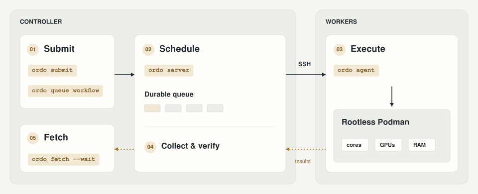

<h1 align="center">
  <picture>
    <source media="(prefers-color-scheme: dark)" srcset="assets/brand/folio-dark.svg">
    <source media="(prefers-color-scheme: light)" srcset="assets/brand/folio-light.svg">
    
  </picture>
</h1>

Ordo makes it easy to schedule reproducible evaluations across SSH-accessible servers.
Exclusive CPU/GPU allocations and worker tags support fair comparisons, while a durable queue, workflows written in Nix, and a local web UI simplify task management.
Every task runs in rootless Podman using a [nix2container](https://github.com/nlewo/nix2container)-built image.

## How it works

<picture>
  <source media="(prefers-color-scheme: dark)" srcset="assets/figures/overview-dark.svg">
  <source media="(prefers-color-scheme: light)" srcset="assets/figures/overview-light.svg">
  
</picture>

`ordo server` drives the workers over SSH and manages scheduling, dispatch, and result collection; nothing of Ordo is installed on a worker.
Submit jobs or workflows, then use `ordo fetch` to retrieve succeeded runs.

[Command reference](https://github.com/r3clab/Ordo/wiki/Command-map) · [Figure notes and source](assets/figures/README.md).

## Direction

Build a focused, single-user evaluation runner for an initial pool of **1–10 workers**, not a general-purpose orchestration platform.
Use **Go** for the server and CLI.

Learn from and selectively adapt:

- [Nomad](https://github.com/hashicorp/nomad) and its [Podman driver](https://github.com/hashicorp/nomad-driver-podman): task lifecycle, container recovery, and resource enforcement.
- [HyperQueue](https://github.com/It4innovations/hyperqueue): dependency-aware scheduling, resource accounting, and indexed CPU/GPU allocation.

Reuse small, relevant code paths and their tests; port HyperQueue logic where worthwhile.
Neither upstream runtime is required.
Prefer a small Go implementation over importing Nomad's full control plane or maintaining a Go/Rust split.

## Deployment

- **Server:** has Nix installed (the Nix-built `ordo` bundles nix2container's `skopeo`); owns the queue, scheduling decisions, and durable run records.
- **Workers:** each has rootless Podman installed and runs no Ordo process.
  The server runs each step as a short shell script over one SSH connection per worker.
- **Tasks:** declare a container image, command, inputs, resource requirements, and outputs.
  Every task runs in **rootless Podman**, never directly on the host.
- **Nix:** provides reproducible tooling and environment builds; Podman remains the task runtime.

Workers must support the resource controls and GPU permissions a task requires.
Unsupported allocations must be rejected, not silently weakened.

## Fair evaluation

Fairness means giving compared runs the same declared hardware resources, not fair-share scheduling between users.

- Assign exclusive CPU cores and GPU devices where requested, with consistent memory budgets.
  Concurrent runs must not share their allocated cores or GPUs.
- Let users define hardware requirements per evaluation with worker tags: a broad tag may suit some experiments; others need a tag shared only by identical machines.
- Pin container images by digest and record code, input, configuration, and seed versions where applicable.
- Preserve worker details, resource assignments, timings, exit status, logs, and outputs.
  Keep failed and retried attempts visible.

Exclusive cores and GPUs do not isolate shared caches, memory bandwidth, or unrelated host activity; these remain measurement risks.

## Workflows and recovery

- Provide a CLI, workflows written in Nix, and a monitoring web UI for your own trusted workloads.
- Support independent tasks, Nix-generated parameter sweeps, and dependency graphs.
- Manage input transfers and output collection over SSH, caching reusable inputs.
- Keep tasks running through server restarts or SSH disconnects.
  Containers carry their attempt ID, so the server finds and collects them after reconnecting, before retries or downstream scheduling.
- Support infrastructure-failure retries and user-defined task retry policies, with bounded attempts.
  A disconnect alone is not proof that a task failed.

## Workers

Workers require Linux, rootless Podman with delegated cgroup v2 `cpuset` and `memory` controllers, OpenSSH, a POSIX login shell, GNU `tar` and `find`, a user systemd manager with `systemd-run`, and lingering enabled for the worker user (`loginctl enable-linger`).
Nothing of Ordo is installed there: the server runs each step as a short shell script over one SSH connection per worker, and Podman's own `conmon` keeps tasks running between steps.
Use a worker-local filesystem for the state directory, not a shared network filesystem; it must be mode 0700.

- The server reaches each worker by its SSH alias, so set `User`, `Port`, and `IdentityFile` in the server's `~/.ssh/config`.
  Authentication must not prompt.
- Each Podman command runs in its own transient user scope (`systemd-run --user --scope`), and a stop runs as a transient user service, so neither ends with the SSH session that started it.
- The CPU pool must contain every online SMT sibling of each selected physical core.
  Requests count **physical cores**, not logical CPUs.
- Ordo's attempts cannot overlap physical cores; their memory limits must fit the configured aggregate budget.
  Unrelated host processes are outside this guarantee.
- Each container is named `ordo-ATTEMPT` and labeled with its attempt and the server's ID.
  The server records an attempt before launching it, and the name allows one container per attempt, so a lost response or a server restart never starts a task twice.
- One server must own each worker account.
  Ordo containers labeled by another server stop the worker from taking new jobs.
- Images are loaded once into the worker user's Podman storage, and inputs are unpacked once under the state directory by content digest.
  Inputs mount read-only at `/inputs/NAME`; links and special files are rejected.
- Tasks write artifacts under `/outputs`.
  After exit, the server streams logs and outputs back, writes `run.json`, and only then removes the container and its run directory.
  Outputs may contain only regular files and directories; anything else blocks the job until it is cancelled.
- A worker reboot fails a running attempt as an infrastructure failure.
  A changed `/etc/machine-id` blocks the attempt instead of adopting another machine's state.
- Cached images and inputs are never deleted automatically.

The opt-in [live checks](tests/README.md) cover server restarts, workflows, and GPU allocation on real workers.

## Durable queue

Start `ordo server`; it reads `$XDG_CONFIG_HOME/ordo/server.json` (`--config FILE` overrides it), which lists 1–10 workers:

```json
{"workers":[{"host":"WORKER","cpus":"0,1,64,65","memory_mib":512}]}
```

- The server keeps its state in `SERVER_DIR`: `--state DIR`, else `$ORDO_STATE`, else `$XDG_STATE_HOME/ordo/server`.
  Every other command finds the server the same way; set `ORDO_STATE` to point a shell at another server.
- A worker's `state_dir` defaults to `~/.local/state/ordo/worker` in the worker user's home.
  The server asks for that home over SSH on first start and remembers it, so a later restart works while the worker is down; set `state_dir` for a worker unreachable on first start.
- Optional keys: `listen` (web UI address, default `127.0.0.1:7331`), `services` and `secrets` (see [task environment](#task-environment)), `nix`, and `skopeo`.
  Unknown keys are rejected.

A task is a JSON object, one per line; any generator may write them, and [Nix](#nix-library) makes a parameter sweep a `map` over a list:

```nix
let
  inherit (ordo.lib) image toJSONL;
  tasks = map (seed: {
    id = "evaluation-${seed}";
    image = image evaluation.images.grep;
    inputs.dataset = "/absolute/path/data";
    args = [ "-c" "run-eval --seed ${seed} /inputs/dataset > /outputs/score" ];
    resources = { cores = 1; memory_mib = 256; };
  }) [ "1" "2" "3" ];
in
pkgs.writeText "jobs.jsonl" (toJSONL tasks)
```

`ordo submit --file jobs.jsonl` queues each line, a job request or a [workflow](#workflows) (stdin without `--file`).

- Every task needs an `id`.
  Resubmitting an ID with the same request returns the existing job, so rerunning a generator only queues what is new; the same ID with a different request is an error.
- It prints one result per line (`id`, `line`, `workflow`, `state`, `existing`, or `error`), keeps going past bad lines, and exits nonzero if any line failed.
- Installables and input paths resolve on the server.
- `image` is a Nix installable, such as a derivation `"/nix/store/….drv^*"` or `"/path/flake#images.grep"`: the server runs `nix build`, exports the nix2container image with nix2container's `skopeo`, and records the build as `image_origin`.
  Exports are cached by store path, so a resubmission repeats only the already-built `nix build`.
  A batch builds its distinct images concurrently, at most four at once across the server, and a failed build fails only the jobs that use it.
- The server finds `nix` on its `PATH` (the config's `nix` overrides it) and uses the nix2container `skopeo` bundled by the Nix build (the config's `skopeo` overrides it).
  Stock `skopeo` lacks the `nix:` transport, so a `go build` binary needs `skopeo` pointing at nix2container's.
- Only the private control socket accepts submissions; the web UI's API has none, since a submission can build Nix code, read server files, and use every configured secret.

`ordo fetch --into results [--id ID …] [--wait]` writes each succeeded job's outputs, `stdout.log`, `stderr.log`, and `run.json` to `results/ID/`, creating `results` private (mode 0700).
It skips jobs whose directory already exists, so a finished result is never fetched again, and receives each one into a temporary directory renamed into place only after its checksum matches.
Without `--id` it selects every job; `--wait` polls until the selected jobs finish.
It prints one line per job and exits nonzero if any selected job did not succeed.
An output named `run.json`, `stdout.log`, or `stderr.log` would collide, so such a job is refused.

`ordo queue list` and `ordo queue get --id ID` inspect jobs.
Every client command accepts `--state` like the server, and talks to its private control socket there.
Server shutdown or disconnection never stops containers; attempts are committed before launch, and the worker's machine ID must match before reconciliation.
A container that disappears or cannot be collected, or a worker whose identity changed, blocks that job rather than rerunning it.
A blocked job keeps its reservation and is never retried; cancel it to release it.
Results must be collected and recorded before the server marks success.

## Web UI

The server also listens on `http://127.0.0.1:7331`; override it with the config's `listen`, such as `"listen":"127.0.0.1:PORT"`.
Only literal loopback bind addresses are accepted.
Read `SERVER_DIR/token` (mode 0600) and paste its bearer token into the page.
The token is stable across restarts, never placed in a URL/cookie/browser storage, and cleared on disconnect or page reload.

For a remote server, use SSH forwarding, for example `ssh -L 7331:127.0.0.1:7331 SERVER`, then open the local URL.
Do not expose the listener with a public proxy; public deployment/TLS/multi-user authorization are deliberately unsupported.
Authenticated API requests additionally enforce loopback Host headers and same-origin browser requests.

The page shows worker connectivity/hardware/reservations and attempt histories, and cancels jobs or whole workflows; queue work with `ordo submit`.
Logs are available after result collection, with the last 1 MiB of each stream shown; full logs remain in each attempt's result directory.
Untrusted task output is rendered as text, not HTML.
Auto-refresh can be paused.

### Developing the UI

The UI source is a Svelte 5, Vite, and Tailwind CSS app in `ui/`.
Its build output in `internal/server/web/` is generated, embedded into the binary, and committed so `go build` and `nix build` need no Node.js step.
Commit `ui/` changes together with a fresh build:

```sh
cd ui
npm ci
npm run check   # type-check
npm run build   # regenerate internal/server/web/
```

`nix flake check` type-checks the UI and fails if the committed build differs from a fresh one.
After changing `ui/package-lock.json`, update `npmDepsHash` in `nix/checks/ui.nix`.

`npm run dev` serves the UI with hot reload and proxies `/v1` to a server listening on `127.0.0.1:7331`.

## GPU workers

Configure a worker's optional `gpus` array with full NVIDIA GPU UUIDs.
Request them with a task's `resources.gpus`.
An omitted pool disables GPU admission; ordinal indices, `all`, MIG partitions, and unsupported device controls are rejected.

- The server reads UUID/model/memory information with `nvidia-smi` and generates a private CDI specification under `STATE/cdi` with `nvidia-ctk` on the worker.
  No global CDI registration or host configuration change is needed.
- GPU reservations are exclusive and durable.
  A configured GPU missing from the worker keeps that worker offline.
  Admission checks compute/graphics processes, not merely utilization; unrelated processes starting afterward remain outside Ordo's guarantee.
- Podman receives only allocated CDI devices, with legacy NVIDIA hook visibility disabled.
  No privileged mode or device-isolation fallback is used.
- GPU images must work with the injected driver libraries; NVIDIA CDI supplies `NVIDIA_CTK_LIBCUDA_DIR`.
  The nix2container GPU fixture uses this directory to load `libcuda.so.1`.
- `tests/gpu-smoke.sh` verifies exactly one visible GPU UUID, a tiny CUDA allocation/set/copy, exclusive allocation, tag matching, and server-restart recovery.
  Run it only against a GPU confirmed free of existing processes.

## Worker tags

Give the workers you consider equivalent a shared tag, such as `"tags":["l40s-class"]` in each of their config entries, then require it in the task's `tags`:

```nix
{ id = "train"; image = image evaluation.images.train; resources = { cores = 1; gpus = 2; memory_mib = 8192; }; tags = [ "l40s-class" ]; }
```

- A job runs only on workers carrying every tag it lists; jobs without tags still run on any worker.
- Submission rejects tags that no single configured worker carries together.
- A job whose tagged workers are full remains queued; it never falls back to an untagged worker.
- A tag describes the whole worker, including every GPU in its `gpus` list.
- Tags are server policy kept in the server config; changing them needs a server restart.

## Task environment

Tasks may declare environment, secrets, network access, capabilities, and controller-side services:

```nix
{ env.MODE = "eval"; secrets = [ "MODEL_TOKEN" ]; network = "egress"; cap_add = [ "NET_ADMIN" ]; services = [ "model" ]; /* … */ }
```

- `env` values are part of the job's specification and appear in job records, `run.json`, and the web UI.
  Names starting with `NVIDIA_` are reserved, since NVIDIA's container hooks read them to inject devices.
- `secrets` lists names only, so task files in the world-readable Nix store hold no values.
  The server supplies them from its config's `"secrets":{"NAME":"FILE"}`, where a relative `FILE` is beside the config, and a task listing `NAME` sees the file's content as `$NAME`.
  Each file is read once at startup, without one trailing newline; a value cannot be empty or contain NUL or line breaks, and is at most 32 KiB.
  Values stay in the server's memory, never in job records, the API, or `run.json`, which lists only names.
  Submission rejects a name the server was not given, and the server refuses to start without a secret that an unfinished job uses.
  Changing a value needs a server restart; later launches receive the new one.
  At launch they travel over SSH standard input into a mode-0600 env file on the worker, removed as soon as `podman run` returns, never through argv.
  `podman inspect` on the worker shows them while the container exists.
  **Anyone who can submit jobs can use every configured secret**, and a task can print one to the logs the web UI shows.
- `network` is `none` (default, loopback only) or `egress` (rootless pasta with full outbound access).
  Domain filtering belongs in the image, for example with nftables under `NET_ADMIN`.
- `cap_add` accepts only `NET_ADMIN`, which acts on the container's own network namespace under rootless Podman.
- `services` names endpoints in the server config's `"services":{"NAME":"HOST:PORT"}`, resolved from the server.
  The server's SSH connection to each worker forwards each one to a Unix socket, and the task sees it at `/services/NAME/socket`, even with `network` set to `none`.
  The directory is mounted rather than the socket, so a task keeps reaching the service after a reconnect; while the server is disconnected, connections fail and the task must retry.
  Only the container's root user (the worker user) can connect.
  Clients that need TCP bridge inside the image, for example `socat TCP-LISTEN:8317,bind=127.0.0.1,fork UNIX-CONNECT:/services/model/socket`.
  Workers' sshd must allow stream-local forwarding (`AllowStreamLocalForwarding`, the default).
  The server refuses a configuration that drops a service an unfinished job uses.

## Workflows

A workflow is a line with an `id` and its `tasks`, which may also name `depends_on` and `from`:

```nix
let
  inherit (ordo.lib) image toJSONL;
  step = args: { image = image evaluation.images.grep; resources = { cores = 1; memory_mib = 128; }; } // args;
in
pkgs.writeText "workflow.jsonl" (toJSONL [{
  id = "example";
  tasks = [
    (step { id = "produce"; args = [ "-c" "printf data > /outputs/value" ]; })
    (step { id = "consume"; from.data = "produce"; args = [ "-c" "cp /inputs/data/value /outputs/value" ]; })
  ] ++ map (seed: step {
    id = "score-${seed}";
    depends_on = [ "produce" ];
    timeout_seconds = 60;
    retry = { task = 1; infrastructure = 1; };
    args = [ "-c" "printf ${seed} > /outputs/seed" ];
  }) [ "1" "2" ];
}])
```

`ordo submit` queues each workflow line atomically: all of its tasks, or none.

- Workflow IDs are at most 24 characters, task IDs 32; jobs use `WORKFLOW--TASK` IDs.
  A workflow holds at most 1,000 tasks.
- `depends_on` requires every referenced task to succeed.
  `from` selects one task's collected output directory and adds its dependency automatically.
- Failed/cancelled dependencies skip downstream tasks; independent branches continue.
- Task-exit retries default to zero, confirmed infrastructure-failure retries to one.
  Each count is bounded to 0–10.
  Every executed attempt remains visible.
  Unknown/disconnected executions do not consume retries.
- `timeout_seconds` is a per-attempt wall-clock limit from container start.
  The server stops an expired container; while the server is unreachable, Podman kills it 60 seconds past the limit.
  Either way the attempt counts as a task failure.
  Zero disables it; the maximum is one year.
- `ordo queue cancel --id JOB_ID` and `ordo queue cancel-workflow --id WORKFLOW_ID` persist cancellation intent.
  A cancelled job ends `cancelled` and its dependents are skipped.
  Unknown outcomes stay blocked until cancelled.
- `ordo queue stop --id JOB_ID` ends a running job early, for example when an external budget runs out, but keeps its result.
  The container gets SIGTERM, then SIGKILL after 10 seconds, and the attempt is collected and classified by its exit status like any other exit, so a task that traps SIGTERM and exits zero succeeds and its dependents run.
  A stopped job is never retried; stopping a job before it starts cancels it.
- Every stop and cancel accepts `--reason TEXT` (up to 1 KiB), recorded as `stop_reason` on the job and attempt.
  Attempts also record `stop_requested`: `cancel`, `stop`, or `timeout`.
  The first request reaching an attempt wins, but a later cancel still marks the job `cancelled`.

## Nix library

Tasks and workflows are plain attrsets with the [wire format](#wire-format)'s fields; the flake's `lib` adds two helpers.

- `image DRV` returns the installable `"/nix/store/….drv^*"`: the task file keeps the `.drv` alive without building the image, which the server builds on submission.
  The `.drv` must be in the server's Nix store, so evaluate on the server host or `nix copy --derivation` it there.
  JSON printed by `nix eval` roots nothing, so garbage collection can remove the `.drv` before submission.
- `toJSONL LINES` writes each task or workflow as one line for `ordo submit`.
- Sweeps and other repetition are plain Nix, such as `map` over seeds or `lib.mapAttrsToList` over images.
- Consumers should make Ordo's `nix2container` input follow their own, so the server's `skopeo` reads their image format.

### Wire format

`ordo submit` reads one JSON value per line: a job request, or a workflow, which is any line with a `tasks` field.
Their fields are snake_case (`resources.memory_mib`, `timeout_seconds`, `cap_add`, `depends_on`).
`ordo schema [request|workflow]` prints their JSON Schema, generated from the Go types; `schema/` holds committed copies for editors and other tools.
The schema covers names, enums, and limits; rules spanning fields, such as input conflicts, are checked only on submission.

## Development

The Nix layout follows [Sermo](https://github.com/r3clab/Sermo): Blueprint assembles outputs from `nix/`, with inputs pinned in `flake.lock`.
Go is pinned through Nixpkgs; the shell also provides `gopls`, `golangci-lint`, and treefmt.
Supported development platforms: x86-64 Linux, ARM64 Linux, and Apple Silicon macOS; execution workers require Linux.

```sh
nix develop                    # or direnv allow
nix fmt                        # Go, Nix, Markdown, YAML, JSON, and spelling
go test -race ./...
golangci-lint run ./...
go run ./cmd/ordo --help
nix build                      # binary at result/bin/ordo
nix flake check                # formatting, lint, build, race-enabled tests, and UI build
```

- `nix/devshell.nix`: tools and a fail-fast formatting/lint pre-commit hook, installed on shell entry.
- `nix/formatter.nix`: treefmt configuration and formatting check.
- `nix/package.nix`: Go build with nix2container's `skopeo` baked in, tests, and sandboxed lint check.
- `nix/lib/default.nix`: `image` and `toJSONL`.
- `nix/checks/ui.nix`: UI type check and committed-build freshness check.
- `nix/checks/schema.nix`: fails when `schema/` differs from `ordo schema --out`; regenerate with `go run ./cmd/ordo schema --out schema`.
- `nix/checks/lib.nix`: validates `lib` output against the schema, with an unbuildable image to prove task files build no images, and requires every invalid sample to fail evaluation.

CI runs `nix flake check` on every push to `main` and every pull request.

Run commits from Ordo's own dev shell so its hooks apply.
Nix's Git-based flakes only see tracked files: add new files to Git before checking, or use `path:.` (for example, `nix develop path:.`) while bootstrapping.
Run `nix flake check` itself Git-backed: a `path:.` snapshot can include `.git`, which makes the formatter check fail with “nothing to commit”.

## Still open

- Exact upstream components and tests to reuse or port.

## License

[MIT](LICENSE) for Ordo's original code.
Upstream code reuse needs a separate license check: Nomad currently uses BUSL-1.1; HyperQueue uses MIT.
